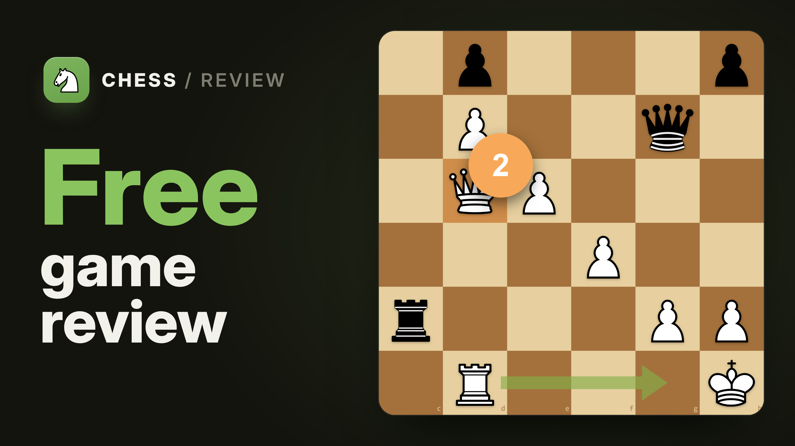

# ♟ Chess Review

Free, open-source game review for your online chess games, powered by Stockfish NNUE running
locally in your browser. One click turns any **Chess.com** or **Lichess** game into a full
review — accuracy scores, move-by-move classifications, an evaluation graph, and an estimated
rating. No account, no server, no manual PGN copying.

**Learn with Chess Review** opens from the button beneath Engine, beside the move
controls. By default, the review panels morph into one learning workspace while
the board and top bar stay in place. **Settings → Visual → Learning experience**
offers **Morph in place**, **Morph in place 2**, **Morph in place 3**, **Studio Morph**, **Minimal morph**, **Board morph**, and
the original **Separate page** layout. Each morph has its own design and timing. The transition
also runs when returning to review and respects reduced-motion preferences.
**Morph in place 2** glides the intact board into a centered study layout and keeps
Settings available alongside learning, with reserved space on desktop windows.
**Morph in place 3** keeps the review board size and familiar piece handling while
the surrounding panels transition into learning.
The learning workspace includes 23 concept lessons with 47
exercises, 50,000 offline puzzles, Time attack and Knockout modes, and 36 opening courses
with 220 annotated lines: at least six variations per opening, and eight each for
the Ruy Lopez and Sicilian Defense. Lessons use move, square-selection and position-reading
exercises. Opening practice supports both colors and automatic opponent replies.
Progress and bookmarks stay in your browser, and **Back to review** restores your
game position and orientation. The [learning objective and progress tracker](docs/LEARN_WITH_CHESS_REVIEW.md)
preserves the full development brief for work on another computer; [content sources](data/learning/SOURCES.md)
record licensing and validation scope.

The former live concept-analysis prototype is retained under
[research/concepts/legacy/](research/concepts/legacy/README.md), including its
proofs, detectors and historical UI tests, for anyone to inspect, implement or
reuse under the repository license. It is separate from the extension and is
excluded from release packages. The learning concept lessons remain available;
their small, bounded exercise validators run only when needed.

**Source:** https://github.com/T-Julsgaard/Chess-Review

**Chrome webshop**: https://chromewebstore.google.com/detail/chess-review/pdbffcjdmcadihmnmenkadndbdbigfam

**Firefox Add-ons**: https://addons.mozilla.org/en-US/firefox/addon/chess-review/

## Watch the introduction

Click the image below to watch the introduction video.

[](https://t-julsgaard.github.io/Chess-Review/marketing/video/media/chess-review-intro.mp4)

## Features

- **One-click review** of any Chess.com or Lichess game — or paste a game URL / raw PGN.
- **Accuracy estimates** for both players, calculated from local Stockfish analysis using the extension's scoring rules. Scores can differ from other review tools.
- **Move classifications** from Brilliant to Blunder, with an evaluation graph and best-move arrows.
- **Estimated rating** — a rough guide to the level each player performed at in the game.
- **Opening detection** from an offline book, named even for PGNs without headers.
- **Rated alternatives** while reviewing a game, using the same classification rules
  as the played moves. Exploring does not change the original game or its accuracy.
- **Stockfish 18 NNUE is the default**, with **Stockfish 19 Lite** as a compact
  alternative. Both are bundled locally and available in Settings.
- **Recoverable analysis errors** with a Retry button; unfinished reviews are not
  saved as completed games.
- **Analysis runs on your machine** — game lookup requests go directly to the chess platforms; no developer backend or analytics.

## Usage

1. Open a finished game on **Chess.com** or **Lichess**.
2. Click the extension icon → **Analyze this game**, or press `Ctrl+Shift+Y`.
3. Stockfish reviews the game in an analysis tab.

You can also paste a game URL or PGN into the popup. Player detection runs locally
and separately for Chess.com and Lichess, using the 50 most recent distinct games
opened for analysis and the saved library (up to 300 games). It requires a clear
frequency lead and several different opponents; ties remain unknown. The site's
board orientation takes priority. Repeatedly watching one player can still produce
an incorrect account guess. A pasted Chess.com URL needs a cached game or known
players' archives; otherwise, open the game on Chess.com or paste its PGN.
Chess Review is intended for review after play.

Choose **Open Chess Review** in the popup to start without a game. The welcome
screen offers learning and your saved game library, without starting Stockfish.
The popup stays open on chess sites until you choose an action; the keyboard
shortcut and in-page review button still launch a game review directly.

Settings let you choose an engine, rating mode, board, pieces, sounds, coach and
category-badge appearance. Badge numbers describe move categories; they are
separate from position evaluation and game accuracy.

**Settings → Visual → Layout → Reorganize panels** unlocks the review layout.
Use each panel’s selection check, **Select right panels**, or **Select all** to
choose a group. Drag a handle to move the group or a corner to scale its spacing,
contents and dimensions together. **Export layout** downloads a JSON proposal
that can be shared for a future default arrangement.

### Screen sizes

Open **Settings → Visual → Screen sizes → Open screen-size preview** to use the
app at desktop, laptop, tablet and phone viewport sizes. The preview starts with
your current game and settings. Choose a resolution, enter custom dimensions or
rotate the viewport without losing your place. **Fit to window** shows the whole
viewport; **100%** lets you inspect it at actual size with scrolling. Dimensions
are browser viewport pixels, and phone/tablet presets test layout rather than
device hardware or touch input. Progress and settings changes stay in the preview
tab and do not change your saved data.


Both engines offer **Use recorded rating** and **Moves only**. The first compares
your performance with public players near the rating saved in the game; the
second ignores that rating and estimates a blitz rating level from your choices.
Without a saved rating, the review falls back to Moves only, which needs at least
ten nonforced decisions. Each engine uses its own models.

## Scoring and reproducibility

Chess Review is open source and uses local Stockfish analysis with documented
scoring models. The repository includes the fitting tools, public-data evidence
and reference results needed to inspect and reproduce the bundled numerical
models.

With Node.js 24 or later, reproduce the bundled coefficients and reference scores
offline:

```sh
node tools/calibration/reproduce-public.mjs
```

This check replays the included evidence without rerunning engine searches. The
[methodology](tools/calibration/PUBLIC_METHOD.md) documents the inputs,
calculations and limitations. Estimated ratings are approximate.

Move categories follow documented classification rules. See the
[special annotations guide](tools/calibration/BRILLIANT_MOVES.md) for their
definitions and sources, and the [repository guide](docs/REPOSITORY.md) for the
supporting files.

## Research and future methods

The separate [research workspace](research/README.md) investigates improvements
to accuracy, estimated ratings and move categories against our own documented
baseline. It records reproducible experiments, successful and unsuccessful
findings, evidence limits and implementation decisions. Research candidates
become part of the extension only through a documented promotion. See the
[research index](research/INDEX.md) for current state and next questions.

## Install

Install from the Chrome Web Store or Firefox Add-ons using the links above.
For a local Chrome installation:

1. Download or clone this repository.
2. Open `chrome://extensions` and enable **Developer mode** (top-right).
3. Click **Load unpacked** and select the project folder.


## Privacy

Games are fetched from Chess.com's and Lichess's public APIs and analyzed locally
with bundled WebAssembly builds of Stockfish. Lookup requests include public player
usernames or game IDs. No games or analysis are sent to the developer or analytics services.
Firefox discloses the browsing activity and website content used for these requests.
Sharing a game copies an encoded, unencrypted PGN/metadata link to your clipboard;
anyone you send it to can read that information. See [PRIVACY.md](PRIVACY.md).

## Maintained-source checks

The Maintained source workflow runs `npm run verify:source` and `npm run verify:history`
before the test suites. The history check inspects reachable commits and historical text
blobs in batches targeting 16 MiB, so growing research history does not overflow one
combined subprocess output buffer. All existing content and path checks remain active.

The complete research suite runs in a separate Windows CI job with the original
Python runtime bound by the E211 saved observations. Setup verifies the pinned
archive, retained executable hash, and full build version; existing research
evidence and checks remain unchanged. See [runtime setup](tools/research-python/README.md).

## Release packages

Run `npm ci`, `npm test`, `npm run verify:engines`, and `npm run build`.
The build creates separate Chrome and Firefox ZIPs under `web-ext-artifacts/`,
with browser-specific manifests and no development dependencies or tests. Each build
has its own release directory, source snapshot, and SHA-256 package checksums.
See [RELEASE.md](RELEASE.md) for store reviewer notes and validation commands.

## License & attributions

Chess Review's own code is licensed under the **GNU General Public License v3.0** (see
[`LICENSE`](LICENSE)), matching the bundled Stockfish engine. Bundled third-party assets (engine,
pieces, sounds, opening book, libraries) keep their own licenses — see
[`ATTRIBUTIONS.md`](ATTRIBUTIONS.md) and [`THIRD_PARTY_NOTICES.md`](THIRD_PARTY_NOTICES.md).
Some asset redistribution rights remain unresolved as documented in the attributions;
the project's GPL license does not grant rights to those assets.
Corresponding source for the GPL/AGPL components is available
from the upstream projects listed there.

> **Disclaimer:** Chess Review is an independent, unofficial tool. It is **not affiliated with,
> endorsed by, or sponsored by Chess.com or Lichess**. Those names are used only to describe the
> sites it reads games from (nominative reference); all trademarks belong to their respective owners.
